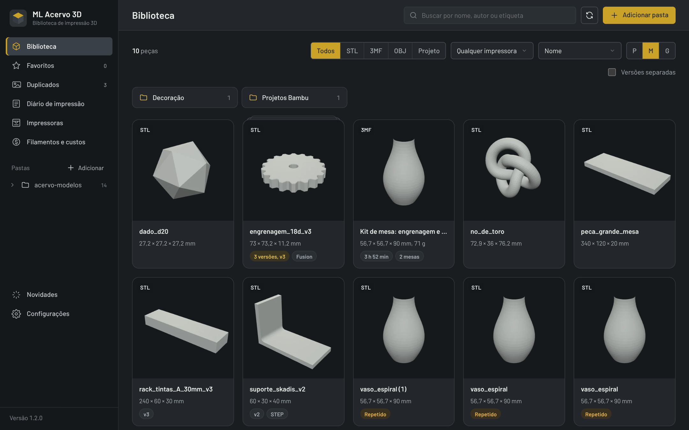

# ML Acervo 3D — atualizações

Biblioteca de arquivos de impressão 3D para Windows (STL, 3MF, OBJ), da ML Lopes Design.

**Grátis.** Baixe com cadastro em [tools.mlopesdesign.com.br/ml-acervo-3d](https://tools.mlopesdesign.com.br/ml-acervo-3d/).

Este repositório só distribui as versões do programa. Cada release traz:

- `ML-Acervo-3D-Setup-vX.Y.Z.exe` — instalador completo
- `ML-Acervo-3D-Setup.exe` — o mesmo instalador com nome fixo (link do site)
- `resources.neu` — arquivo de atualização que o programa baixa sozinho

O programa instalado procura a release mais recente ao abrir e a cada 6 horas.
O código-fonte não fica aqui.
